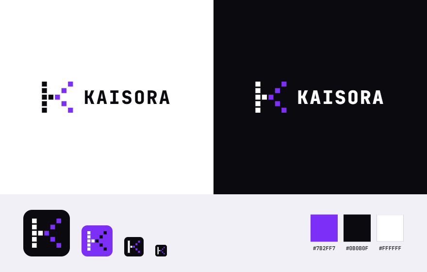

# Design System: Kaisora Systems

## Overview

**Creative North Star: "The Running System"**

Kaisora's world is a dark developer-tool console: a near-black ground, charcoal panels drawn with 1px hairlines, an off-white grotesk, and one brand-purple signal taken from the Pixel K logo. Nothing is claimed that can't be shown; the brand's evidence is a real production architecture rendered as a live diagram, with requests visibly travelling through it. Every other surface (service cards, the featured project, case studies, the founder block) is built from the same panel-and-hairline material so the whole site reads as one instrument.

Density is calm and precise rather than packed. Sections are separated by generous vertical space (112px margin plus 96px padding over a single top hairline), panels carry their content with modest internal padding, and type is tight-tracked and heavy only at the top of the hierarchy. Dark is the home theme; light mode is the same system inverted through the same tokens, not a separate design.

The accent is rare and functional. Purple fills the one primary action per region and marks things that are live: path lines, pulses, junction dots, status text, step counters. Mono type appears only where the content is genuinely system data.

**Key Characteristics:**
- Near-black ground, charcoal panels, 1px translucent-white hairlines in three strengths.
- One accent in two forms: the brand purple (#7B2FF7) as a fill for primary actions, and a lifted tint (#A87BFF) for live lines, dots and accent text.
- Rethink Sans for every voice; Geist Mono only for real system data.
- Flat surfaces separated by hairlines; one soft ambient shadow reserved for the live system panel.
- Motion that represents work (pulses, an event feed), and stops entirely under reduced motion.
- Dark default, light as an inversion, switched by `data-theme` on `<html>`.

## Brand

The source of truth is the owner-supplied brand sheet at `brand/kaisora-pixel-k-sheet.png`. It shows the logo on light and dark, the app icon at four sizes, and the three brand colours: **#7B2FF7** purple, **#0B0B0F** near-black and **#FFFFFF** white. The site's accent and ground come straight from it.

### The Pixel K

The mark is a K built from eleven squares on a 5 × 5 grid. In SVG units the pitch is 4 and each square is 3, so the viewBox is `0 0 19 19`.

- **Ink squares (stem and arm):** column 0 rows 0–4, plus column 1 row 2. They are white (`mark-ink`) on dark grounds and near-black (`light-mark-ink`) on light grounds.
- **Purple squares (the diagonal):** (2,2), (3,1), (4,0), (3,3) and (4,4). They are always `brand-purple` #7B2FF7 in both themes; never the lifted tint.
- **Rendering:** always `shape-rendering: crispEdges`. The squares must never be rounded, outlined or animated.

### Logo lockup

- The Pixel K sits left of the **KAISORA** wordmark: Geist Mono 700, uppercase, 0.06em tracking (`typography.wordmark`).
- The mark is about twice the wordmark's cap height. In the header that is a 28px mark beside 18px type, with a 12px gap.
- Source: `src/components/site/wordmark.tsx` (`PixelK`, `Wordmark`).

### Files

| Asset | Path | Use |
| --- | --- | --- |
| Brand sheet | `brand/kaisora-pixel-k-sheet.png` | Reference only |
| Mark on dark | `public/brand/kaisora-mark-on-dark.svg` | White and purple squares |
| Mark on light | `public/brand/kaisora-mark-on-light.svg` | Near-black and purple squares |
| App icon | `public/brand/kaisora-app-icon.svg` | Near-black rounded tile (rx 14 on 64), white and purple K at 2× |
| Favicon | `src/app/icon.svg` | Same as the app icon |
| Apple touch icon | `src/app/apple-icon.png` | 180 × 180, square; iOS rounds it |

### Named Rules

**The Fixed Purple Rule.** The diagonal of the K is always #7B2FF7, on any ground. Text and lines may use the lifted tint for contrast; the logo never does.

**The Square Grid Rule.** Rebuild the mark only from its grid. Never trace it, redraw it, or pair it with a different wordmark face.

## Colors

A monochrome charcoal ramp carrying a single purple signal, defined once as CSS custom properties and remapped per theme.

### Primary
- **Signal Purple** (`signal-purple`): the fill of every primary action (Start a project, Read the case study, Visit the website), the skip link, and text selection. Always paired with white text (`on-signal`). Identical in both themes; hover deepens toward the theme (`signal-purple-hover` in dark, `light-signal-hover` in light).
- **Signal Tint** (`signal-tint`): the accent as light on dark. Live dots, the travelling pulses and junction ticks, the event strip text, service icons, step counters, provenance lines under titles (featured meta, case-study kind, founder role), link-hover states and the focus ring. In light mode this role is taken by `light-signal-text` (#6a1fe0), a deeper cut of the brand purple, so accent text stays legible on white.
- **Signal Line** (`signal-line`): the architecture's wiring. Main path hairline, SVG connectors, step rails, active-node borders, the dashed branch box in case-study diagrams, and link underlines.
- **Signal Glow** (`signal-glow`): a soft halo only. The hero bloom, the contact bloom, the glow under ticks and step dots, and the primary-button hover shadow. Never a fill.

### Neutral
- **Ground** (`ground`): page background. **Ground Raise** (`ground-raise`) sits one step up for the event strip and screenshot frames.
- **Panel** (`panel`) and **Panel 2** (`panel-2`): every card, node and container; Panel 2 is the hover state for cards and ghost buttons.
- **Hairlines** (`hairline`, `hairline-2`, `hairline-3`): section dividers and inner rules use the faintest; card and control borders use the middle; hover borders use the strongest.
- **Ink** (`ink`, `ink-2`, `ink-3`): headings and primary text; secondary body and ledes; captions, metadata labels, footer and node sub-labels.
- **Light theme** (`light-*` keys): the same roles inverted, near-white ground with white panels and near-black ink at 9/15/28% black hairlines.

### Named Rules
**The One Signal Rule.** Purple is the only hue in the system. It marks a primary action or something live; it never decorates a heading, a background field or a body paragraph.

**The Fill and Tint Rule.** The deep purple is a fill (with white text); the light tint is a line, a dot or a short run of text. Never set tint text on a purple fill, and never use the deep purple as text on the dark ground.

**The Inverted Twin Rule.** Light mode is not designed separately. Any new token gets a value in both `html[data-theme]` blocks, or it does not ship.

## Typography

**Display Font:** Rethink Sans (with ui-sans-serif, system-ui)
**Body Font:** Rethink Sans (400–700)
**Label/Mono Font:** Geist Mono (400–600, tabular numerals)

**Character:** One confident grotesk carries headline, body and controls, tightened at large sizes; a quiet mono appears only as the voice of the machine.

### Hierarchy
- **Display** (`display`): the homepage hero headline only, capped near 10.4em measure.
- **Display Page** (`display-page`): case-study titles and the contact headline (contact uses line-height 1.02).
- **Headline** (`headline`): section titles ("What we build", "Selected work").
- **Title** (`title`): case-study section heads (24px), the founder name (26–32px, one step under the section title) and the featured project title (28px, same weight and tracking).
- **Title Small** (`title-sm`): card heads, service names, step heads (15–18px, 600).
- **Body** (`body`): default copy; ledes in `ink-2` at 30–40em measure.
- **Body Long** (`body-long`): case-study prose, 720px column max.
- **Label** (`label`): buttons (600), nav links and node labels (500), 13–13.5px.
- **Data** (`data`): Geist Mono 9–12px for node sub-labels, the panel name and status, the environment tag, the event strip, technology tags and numbered counters.

### Named Rules
**The Real Data Rule.** Mono is reserved for content a system would actually emit: service names and roles, environments, events, technology tags, ordinal counters. It is never used for section labels, decoration or "techy" flavour.

**The No Kicker Rule.** Headings stand alone. No eyebrow or kicker line above a title; provenance (project type, role) goes beneath the title in accent text.

## Layout

A single centred column, `min(1192px, 100% - 48px)` wide (32px total gutter under 640px). Sections stack vertically, each opened by a full-width top hairline with 112px above and 96px below it (88px on phones); the contact block opens with 140px. Inside sections, grids carry the content: services in three columns, steps in four, the featured project as a 0.9/1.1 split, the founder as a 360px name column (name, role, links) beside the bio, case studies as a 200px sticky contents rail beside a 720px reading column.

The sticky header is 50px, a three-column grid (wordmark, centred nav, action) over a translucent blurred ground.

Breakpoints: 1100px tightens node and nav spacing; 980px drops the nav, stacks all two-column splits, and turns the system graph vertical (the request path reads top to bottom on a single trunk, services in two columns, connectors and pulses hidden); 640px goes to single columns throughout, stacks the event strip and footer, and lets hero buttons flex full width.

## Elevation & Depth

The system is flat. Depth comes from tonal steps (ground, ground raise, panel, panel 2) and hairline borders, not shadows. One ambient shadow exists, and it belongs to the live system panel, lifting the brand's proof slightly off the page. Light, not shadow, provides the remaining depth: a purple radial glow seen through a fine 64px grid behind the hero, and a softer bloom over the contact section.

### Shadow Vocabulary
- **Panel lift** (`box-shadow: 0 1px 0 rgb(255 255 255 / 0.03) inset, 0 24px 48px -24px rgb(0 0 0 / 0.6)`; light: `0 1px 2px rgb(10 10 11 / 0.04), 0 24px 48px -28px rgb(10 10 11 / 0.18)`): the live system panel only.
- **Signal hover** (`box-shadow: 0 8px 24px -10px var(--accent-glow)`): primary button on hover.
- **Tick glow** (`box-shadow: 0 0 8px var(--accent-glow)`): junction ticks and step dots.

### Named Rules
**The Hairline Rule.** Containers are separated by 1px translucent borders and tonal steps. If a new card needs a shadow to read as a card, its border or tone is wrong.

## Shapes

Gently squared corners on a tight four-step scale: 4px for tags, environment chips and the focus ring; 5px for buttons, the theme toggle, the event strip and diagram chips; 6px for cards, nodes and screenshots; 8px for the large containers (system panel, featured project, project brief). Circles are reserved for live dots and ticks. Borders are always 1px solid; the only dashed border marks a branch group in case-study architecture diagrams. Lines are geometric: straight hairlines and orthogonal SVG connectors with small rounded elbows.

## Components

### Buttons
Compact, quiet and decisive.
- **Shape:** gently squared (5px), 40px tall, 600-weight 13.5px label, optional trailing 13–15px line icon.
- **Primary:** Signal Purple fill, white text. One per region.
- **Hover / Focus:** fill deepens and a soft purple glow appears beneath; the trailing arrow slides 3px right. Focus is a 2px tint outline at 3px offset.
- **Ghost:** transparent with a `hairline-2` border and ink text; hover strengthens the border and fills with Panel 2.
- **Small:** 34px tall, 18px padding, used in the header.

### Chips (Tags)
- **Style:** transparent, 1px `hairline-2` border, 4px radius, Geist Mono 11.5px in `ink-2`. Technology names only.
- **State:** static; no selected or filter variants exist.

### Cards / Containers
- **Corner Style:** 6px (cards, services, nodes), 8px (large panels).
- **Background:** Panel; hover moves to Panel 2 with a stronger border on interactive cards.
- **Shadow Strategy:** none (see Elevation).
- **Border:** 1px `hairline-2`.
- **Internal Padding:** 20–28px for cards, 40px for the featured panel (28px tablet, 20px phone).

### Navigation
Sticky 50px header, translucent ground with a 12px backdrop blur and a bottom hairline. Wordmark at 19px/600 with a tint-coloured mark; nav links in 13.5px/500 `ink-2`, hover to `ink`; the small primary button on the right. Below 980px the nav links are removed, leaving wordmark and action. Case studies add a sticky contents rail whose hover state draws a tint left border.

### Capability rows
Full-width link rows divided by hairlines: label and title, description, and a trailing "go" link. On hover the title and go link turn tint and the arrow slides 4px.

### Process steps
Four columns, each topped by a `signal-line` rail with a glowing tint dot at its left end and a mono two-digit counter in tint.

### Live System Panel (signature)
The SherryBerries production architecture as a working figure. An 8px Panel with the panel-lift shadow; a 44px head with the system name in mono beside a pulsing live dot and a "Live system" status with a mono environment chip. Body: five nodes on one `signal-line` hairline with ticks midway, two 36px gradient pulses travelling the path every 4.8s, and six branch services fed by orthogonal SVG connectors whose dash pulses (7/93 dash, 3.6s, staggered 0.55s) flow down from the API node. Nodes are 62px tall, 6px radius, a line icon plus a sans label and mono sub-label. The foot is the event strip: a 29px Ground Raise bar of mono tint text that cycles real event pairs every 4.2s with a 0.6s rise-in. The structure is real lists for screen readers; links and pulses are hidden from assistive tech. Under reduced motion every loop stops, pulses are removed and the strip rests on its first event. Below 980px the graph goes vertical with connectors and pulses hidden.

### Architecture diagram (case studies)
The static sibling of the live panel: a vertical stack of 6px nodes joined by short `signal-line` connectors, an anchor node outlined in `signal-line`, and dashed branch groups holding 5px chips.

## Do's and Don'ts

### Do:
- **Do** fill exactly one primary action per region with Signal Purple and white text; everything else is ghost or text.
- **Do** build every new container from Panel, a 1px `hairline-2` border and the 6px or 8px radius.
- **Do** use the tint for live states, connectors and short accent text, and Signal Purple for that text in light mode.
- **Do** set system data (service names, environments, events, tags, counters) in Geist Mono, and everything else in Rethink Sans.
- **Do** open each section with a top hairline and the 112px/96px rhythm.
- **Do** give every looping animation a resting state and stop it under `prefers-reduced-motion`.
- **Do** define every new colour token in both theme blocks.

### Don't:
- **Don't** introduce a second accent hue; the comp's aqua was replaced by purple and must not return.
- **Don't** put an eyebrow or kicker above a heading.
- **Don't** use mono for labels, headings or decoration.
- **Don't** apply gradients to text, or use purple as a large background field; glows stay soft halos behind content.
- **Don't** add shadows to cards; the panel-lift shadow belongs to the live system panel alone.
- **Don't** fill sections with icon grids; icons are single-colour line glyphs inside nodes, services and buttons.
